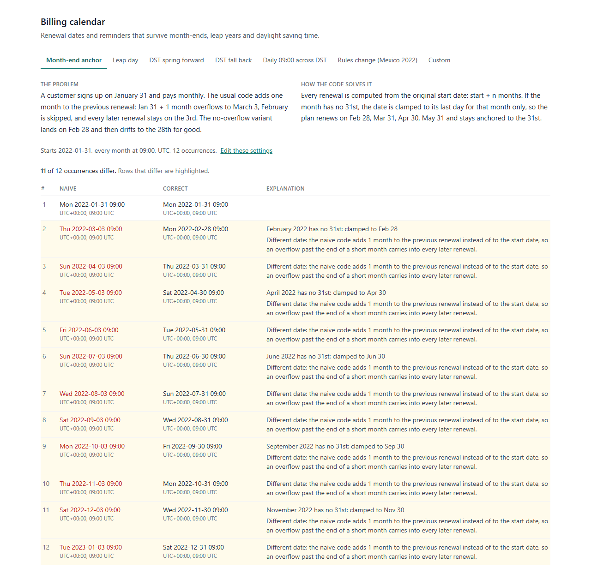
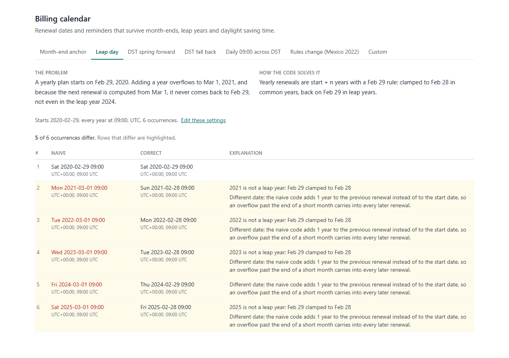
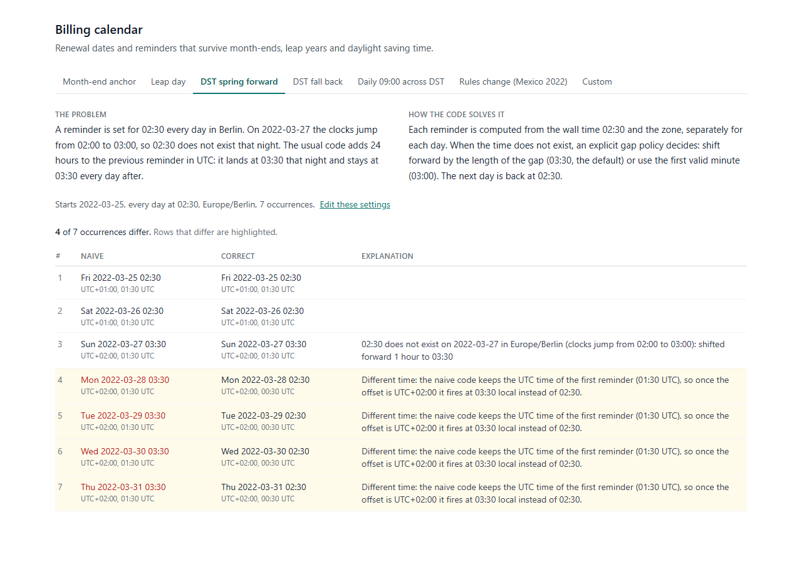
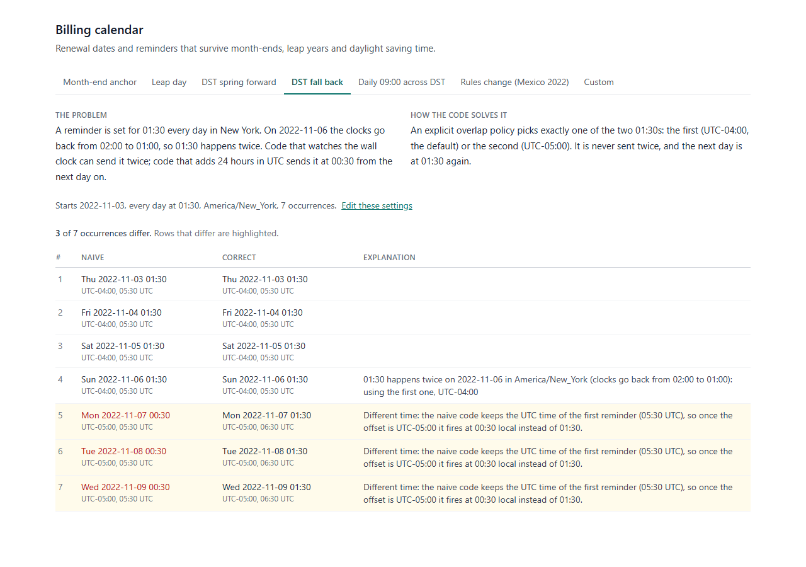
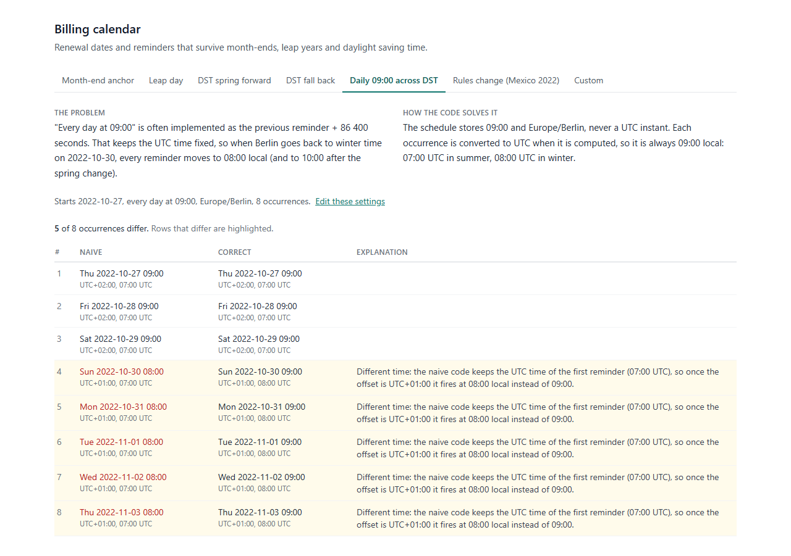
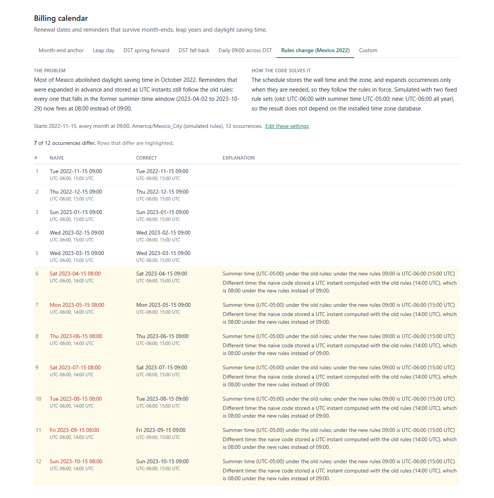
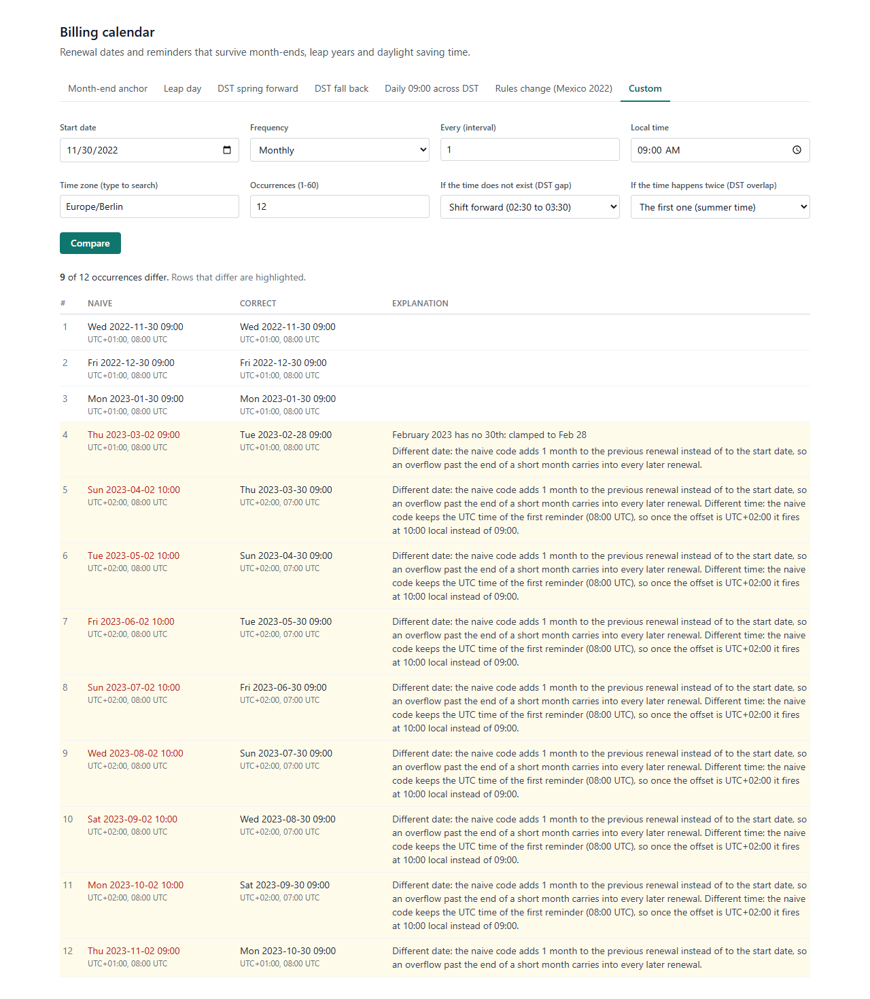

# Billing calendar

Subscription renewal dates and reminders that survive month-ends, leap years and daylight saving time.

A small Laravel 9 tool that computes **when a subscription renews** and **when its reminder should fire**, and
shows the result side by side with the code most projects write, so you can see exactly where that code goes wrong
and why.



- One page, one JSON endpoint, no database.
- All the logic lives in [`app/Scheduling/`](app/Scheduling): plain PHP classes, independent of the framework.
- Every edge case below is covered by tests and has its own tab in the UI, with a plain-language explanation on every
  row that differs.

## Contents

- [The problem](#the-problem)
- [How the engine solves it](#how-the-engine-solves-it)
- [Scenarios](#scenarios)
- [Quick start](#quick-start)
- [Running the tests](#running-the-tests)
- [API](#api)
- [Project layout](#project-layout)
- [Design decisions](#design-decisions)
- [Limits](#limits)

## The problem

Every subscription product stores something like "renews monthly" and "remind the customer at 09:00 the day before".
Most implementations get the dates wrong in ways that only show up weeks later, in production, for some customers:

| # | Edge case | What the usual code does | Real consequence |
|---|-----------|--------------------------|------------------|
| 1 | **Month-end anchor**: signed up Jan 31, monthly | `addMonth()` overflows: Jan 31 → **Mar 3**. Or each date is computed from the previous one: Jan 31 → Feb 28 → **Mar 28 → Apr 28…** forever | Customers billed on the wrong day; the renewal date drifts permanently |
| 2 | **Leap day**: yearly plan started Feb 29, 2020 | Overflows to **Mar 1** in common years, or drifts to Feb 28 forever | Annual renewals a day late, or never back on the 29th |
| 3 | **DST spring forward**: reminder at 02:30 on the night the clocks jump 02:00 → 03:00 | The local time **does not exist**; the code throws, silently shifts, or keeps the shift for good | Reminder never sent, or sent at an unpredictable time |
| 4 | **DST fall back**: reminder at 01:30 on the night 01:00–02:00 happens twice | The local time **exists twice**; naive logic sends it twice, or an hour early from then on | Duplicate emails, or reminders at 00:30 |
| 5 | **"Every day at 09:00" as +86 400 seconds** | After a DST change the reminder moves to 08:00 or 10:00 local | Every reminder after the change lands an hour off |
| 6 | **Time zone rules change**: most of Mexico abolished DST in October 2022 | Future reminders were pre-computed and stored as UTC instants with the old rules | Every stored reminder in the former summer-time window (2023-04-02 to 2023-10-29) fires an hour early |

## How the engine solves it

| # | Edge case | Solution |
|---|-----------|----------|
| 1 | Month-end anchor | Occurrence *n* is computed from the **original start date**: `start + n months`, never from the previous occurrence. If the target month is too short, the date is clamped to its last day **for that month only**: Jan 31 → Feb 28 → Mar 31 → Apr 30 → May 31. |
| 2 | Leap day | Same rule for years: a Feb 29 anchor renews on Feb 28 in common years and on Feb 29 again in leap years. |
| 3 | DST gap | Each reminder is a **wall time + IANA zone**, resolved separately for each date. A nonexistent time is settled by an explicit **gap policy**: `shift_forward` (02:30 → 03:30, default) or `next_valid_minute` (02:30 → 03:00). |
| 4 | DST overlap | An ambiguous time is settled by an explicit **overlap policy**: `earlier` (the first 01:30, default) or `later` (the second). Exactly one instant, never both. |
| 5 | 09:00 across DST | Nothing is stored in UTC. 09:00 stays 09:00 local; only its UTC equivalent changes (07:00 UTC in summer, 08:00 UTC in winter in Berlin). |
| 6 | Rules change | Occurrences are expanded from the wall time **when they are computed**, so they follow the rules in force at that point instead of the rules that applied when the subscription was created. |

Every adjusted occurrence carries a note that explains what happened, for example:

- `February 2022 has no 31st: clamped to Feb 28`
- `2021 is not a leap year: Feb 29 clamped to Feb 28`
- `02:30 does not exist on 2022-03-27 in Europe/Berlin (clocks jump from 02:00 to 03:00): shifted forward 1 hour to 03:30`
- `01:30 happens twice on 2022-11-06 in America/New_York (clocks go back from 02:00 to 01:00): using the first one, UTC-04:00`

The resolver does not trust the library's default behaviour. It works out every instant the wall time could map to,
using the offsets the zone uses around that day, and keeps only the ones the zone really uses at that instant. One
match is the normal case, none is a gap, two is an overlap. This works the same for whole-hour changes, the 30-minute
change of `Australia/Lord_Howe`, the southern hemisphere and fixed offsets.

## Scenarios

Each tab fills in a schedule that triggers one edge case and runs both calculations. The **Naive** column is the
usual code ([`NaiveCalculator`](app/Scheduling/NaiveCalculator.php), deliberately broken); the **Correct** column is
the engine ([`CorrectCalculator`](app/Scheduling/CorrectCalculator.php)). Rows that differ are highlighted and
explained. The line above the table says how many differ, for example "4 of 7 occurrences differ".

### Month-end anchor

Jan 31, 2022, monthly. The naive code skips February and stays on the 3rd; the engine renews on the last day of
short months and returns to the 31st.


### Leap day

Feb 29, 2020, yearly. The naive code moves to Mar 1 for good, even in 2024; the engine uses Feb 28 in common years
and Feb 29 in leap years.



### DST spring forward

02:30 daily in Europe/Berlin around 2022-03-27, when 02:30 does not exist. Both land on 03:30 that night (the engine
explains why), but from the next day the naive code stays at 03:30 while the engine returns to 02:30.



### DST fall back

01:30 daily in America/New_York around 2022-11-06, when 01:30 happens twice. The engine picks one of them by policy;
the naive code fires at 00:30 from the next day on.



### Daily 09:00 across DST

09:00 daily in Europe/Berlin from 2022-10-27. After the clocks go back on 2022-10-30, the naive "+86 400 s" reminder
fires at 08:00; the engine stays at 09:00.



### Rules change (Mexico 2022)

Monthly at 09:00 in America/Mexico_City from 2022-11-15. The naive side was expanded in advance under the old rules
and stored in UTC, so its reminders from April to October 2023 fire at 08:00. The engine expands from the wall time
under the new rules and stays at 09:00.

This scenario is **simulated** with two fixed rule sets
([`MexicoRulesChange`](app/Scheduling/MexicoRulesChange.php)), so the result is the same whatever version of the time
zone database is installed:

- old rules: UTC-06:00, with summer time UTC-05:00 from the first Sunday of April to the last Sunday of October;
- new rules: UTC-06:00 all year.



### Custom

Any start date, frequency, interval, local time, time zone (searchable list of IANA zones) and DST policies, up to 60
occurrences. "Edit these settings" on any preset copies it into this form.



## Quick start

You need [Docker Desktop](https://www.docker.com/products/docker-desktop/) (Windows, macOS or Linux). Nothing else
has to be installed: PHP, Composer and Node run in containers.

```bash
git clone <repository-url> billing-calendar
cd billing-calendar
docker compose up -d
```

Then open <http://localhost:8000>.

The first start takes a few minutes. The `node` container installs the frontend packages, builds the CSS and
JavaScript, and exits. The `app` container then creates `.env`, generates the app key, installs the PHP packages and
starts the server. Later starts are fast. To follow the first start, run `docker compose logs -f app`.

To stop: `docker compose down`.

## Running the tests

```bash
docker compose exec app vendor/bin/pest          # all tests
docker compose exec app vendor/bin/pint --test   # code style (Laravel preset)
```

The unit tests in [`tests/Unit/Scheduling`](tests/Unit/Scheduling) cover the engine on its own:

- Jan 31 monthly for 24 months, every month-end start (28th, 29th, 30th, 31st, common and leap years);
- Feb 29 yearly across 8 years, and intervals such as every 3 months from Nov 30;
- the Europe/Berlin gap on 2022-03-27 with both policies, including the exact edges of the gap;
- the America/New_York overlap on 2022-11-06 with both policies, never two instants;
- 09:00 staying at 09:00 local across both DST changes, weekly for a whole year in five zones;
- Australia/Sydney (southern hemisphere), Australia/Lord_Howe (30-minute change), Asia/Kolkata (+05:30) and
  Asia/Tokyo (no DST);
- the simulated Mexico rules change, including the exact old summer-time boundaries.

The feature tests in [`tests/Feature`](tests/Feature) cover the endpoint (valid requests, invalid zone, invalid
date, count limits, every other field) and the page.

## API

`GET /api/schedule`

| Parameter | Required | Values |
|-----------|----------|--------|
| `start` | yes | start date, `YYYY-MM-DD` |
| `frequency` | yes | `daily`, `weekly`, `monthly`, `yearly` |
| `interval` | no | 1-100, default 1 |
| `time` | yes | local time, `HH:MM` (24 h) |
| `zone` | yes, unless `scenario` is set | IANA time zone, e.g. `Europe/Berlin` |
| `gap` | no | `shift_forward` (default) or `next_valid_minute` |
| `overlap` | no | `earlier` (default) or `later` |
| `count` | no | 1-60, default 12 |
| `scenario` | no | `mexico-2022` runs the simulated rules change |

Example: `/api/schedule?start=2022-01-31&frequency=monthly&time=09:00&zone=Europe/Berlin&count=2`

```json
{
    "rule": { "start": "2022-01-31", "frequency": "monthly", "interval": 1, "time": "09:00", "zone": "Europe/Berlin",
              "gap": "shift_forward", "overlap": "earlier", "count": 2, "scenario": null },
    "naive": [
        { "index": 0, "date": "2022-01-31", "weekday": "Mon", "time": "09:00", "offset": "+01:00", "utc": "2022-01-31T08:00Z", "notes": [] },
        { "index": 1, "date": "2022-03-03", "weekday": "Thu", "time": "09:00", "offset": "+01:00", "utc": "2022-03-03T08:00Z", "notes": [] }
    ],
    "correct": [
        { "index": 0, "date": "2022-01-31", "weekday": "Mon", "time": "09:00", "offset": "+01:00", "utc": "2022-01-31T08:00Z", "notes": [] },
        { "index": 1, "date": "2022-02-28", "weekday": "Mon", "time": "09:00", "offset": "+01:00", "utc": "2022-02-28T08:00Z",
          "notes": ["February 2022 has no 31st: clamped to Feb 28"] }
    ],
    "differences": [
        { "index": 1, "reason": "Different date: the naive code adds 1 month to the previous renewal instead of to the start date, so an overflow past the end of a short month carries into every later renewal." }
    ],
    "summary": { "total": 2, "differing": 1 }
}
```

Invalid input returns `422` with Laravel's usual `{"message": ..., "errors": {field: [...]}}` body.

## Project layout

```
app/Scheduling/
    Frequency.php            daily, weekly, monthly, yearly
    GapPolicy.php            what to do with a time that does not exist
    OverlapPolicy.php        which of two identical times to use
    RecurrenceRule.php       start date, frequency, interval, wall time, IANA zone, policies (validated)
    Occurrence.php           one occurrence: local time, UTC instant, offset, notes
    CorrectCalculator.php    the engine: anchor-based dates + wall time resolved per occurrence
    LocalTimeResolver.php    detects DST gaps and overlaps and applies the policy
    NaiveCalculator.php      the usual, broken approach, for comparison only
    MexicoRulesChange.php    deterministic simulation of the 2022 rules change
    ScheduleComparison.php   runs both and explains every difference
app/Http/Controllers/ScheduleController.php   GET /api/schedule
app/Http/Requests/ScheduleRequest.php         validation
app/Scenarios.php                             the preset tabs and their explanations
resources/views/schedule.blade.php            the page (Blade + Alpine.js + Tailwind CSS)
```

Stack: PHP 8.1, Laravel 9, Carbon 2 (`CarbonImmutable` only), Pest 1, Laravel Pint, Vite 3, Tailwind CSS 3,
Alpine.js 3.

## Design decisions

**Anchor-based, not chained.** Occurrence *n* is `start + n × interval`, clamped when the month is too short. Chaining
(`previous + 1 month`) turns a one-off clamp into a permanent drift, because the clamped date becomes the base of
every later one. With an anchor, a short month affects only itself.

**Wall time + zone, not UTC.** A reminder means "09:00 where the customer lives", so that is what is stored: `09:00`
and `Europe/Berlin`. The UTC instant is derived per occurrence, when it is needed. Storing UTC instants up front bakes
in the offsets and rules of the day they were computed, which breaks at every DST change and every rules change.
Calendar dates are kept at midnight UTC internally, so date arithmetic never touches DST.

**Explicit DST policies.** Gaps and overlaps are not errors, they are real local times that need a decision. Instead of
relying on what the date library happens to do, the policy is a visible, per-schedule setting with a safe default
(`shift_forward`, `earlier`), and every decision is written into the occurrence's notes.

**The broken version is part of the product.** `NaiveCalculator` is kept on purpose and clearly labelled. Showing the
two side by side, with the reason for each difference, explains the problem better than any description.

## Limits

- **No persistence.** Nothing is saved; every request computes the schedule from scratch, which is also the point of
  the design.
- **The rules change is simulated.** The Mexico scenario uses two hand-written rule sets instead of the time zone
  database, so it is deterministic. All other zones use the time zone database bundled with PHP.
- **Not a billing system.** No payments, proration, emails or accounts: only the dates and times.
- **One clock change per day at most.** The resolver compares the offsets one day before and one day after the wall
  time, so it assumes the clocks change at most once in that window, which is true for real time zones.

## License

[MIT](LICENSE)
